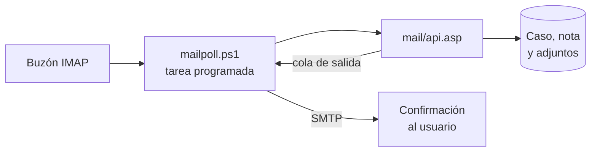

<div align="center">

# 🛠️ Liberum Help Desk

**A "free", web-based help desk solution — ahora con interfaz moderna, informes de ANS y correo a caso.**


[🆕 Novedades](#-novedades-de-esta-versión) ·
[📖 About](#i-about) ·
[📋 Requirements](#ii-requirements) ·
[⚙️ Installation](#iii-installation) ·
[⬆️ Upgrading](#iv-upgrading) ·
[🗄️ Databases](#v-databases) ·
[✉️ Email](#vi-email) ·
[🔑 Authentication](#vii-authentication) ·
[🔎 Full text](#viii-sql-full-text-searching) ·
[🌐 IIS](#ix-iis-configuration)

</div>

---

> Liberum Help Desk, Copyright (C) 2001 Doug Luxem
> Liberum Help Desk comes with ABSOLUTELY NO WARRANTY.
> Please view the `license.txt` file for the full GNU General Public License.
>
> **Version:** 0.98 · **Date:** TBD
> Please view [`changelog.txt`](changelog.txt) for changes in this version.
>
> **WEB:** http://www.liberum.org · **SUPPORT:** http://www.liberum.org/support.html

---

# 🆕 Novedades de esta versión

Resumen de lo que se agregó o cambió sobre la base original. Las rutas son relativas a la carpeta `www`, salvo que se indique otra cosa. La documentación original de Liberum se conserva completa más abajo, sin cambios.

## ✨ Lo más destacado

| | Novedad | Dónde |
|---|---|---|
| 🎨 | Interfaz moderna con tarjetas, paleta de colores propia y login rediseñado | todas las vistas |
| 🔎 | Listas desplegables con buscador | `searchselect.js` |
| 📎 | Adjuntos con arrastrar y soltar y validación de tamaño | `js/lhd-editor.js` |
| 📊 | Informe de cumplimiento de ANS con exportación a CSV | `admin/reportans.asp` |
| ✉️ | Correo a caso: un correo crea el caso y la respuesta agrega una nota | `mail/api.asp` |
| 🔐 | Endurecimiento de `web.config` y revisión de seguridad | `web.config` |
| ⚡ | Cachés por petición e índices en la base de datos | `public.asp`, `db/` |

## 🎨 Interfaz

- **Vistas modernizadas** con tarjetas, botones de acción arriba y paginación: menú de usuario y de técnico, listados, detalle de caso, nuevo caso, tablero In/Out, registro, recuperar contraseña, base de conocimiento y todo el menú de administración.
- **Íconos SVG** (`js/lhd-icons.js`): reemplazan los emojis que en algunos equipos se veían como cuadros.
- **Listas con buscador**: todas se pueden filtrar escribiendo. Se omiten las múltiples, las de fechas y las marcadas con `data-nosearch`.
- **Notificaciones** con Toastify (`js/lhd-toast.js`) al guardar, subir archivos o ante errores.
- **Adjuntos**: zona de arrastrar y soltar (Dropzone), cola de subida con estado por archivo y validación del tamaño máximo configurado.
- **Paleta de colores** guardada en `tblTheme` y aplicada en todas las vistas (`theme.asp`, `admin/colors.asp`).
- **Cambio de vista** usuario ↔ técnico desde el menú lateral, y casos cerrados disponibles en ambas.
- **Inicio de sesión** (`logon.asp`) y **acceso de administración** (`admin/default.asp`) con diseño de dos paneles, campos con ícono, botón para mostrar la contraseña, aviso de mayúsculas e indicador de carga.

> 🔒 El acceso de administración se bloquea 10 minutos después de 5 claves incorrectas desde la misma IP.

## 📊 Informes y administración

**Informe de cumplimiento de ANS** — `admin/reportans.asp` compara, por caso, el tiempo de respuesta inicial y de solución con el ANS de su categoría. Incluye resumen, filtros, paginación y exportación a CSV.

> Requiere ejecutar `db/problems_first_response_sqlserver.sql`.

<details>
<summary><b>Categorías</b></summary>

- Se muestra y edita el técnico asignado.
- El nombre ya no se puede cambiar, para no alterar el histórico.
- Columnas nuevas editables: estado, ANS, tipo de ANS (M/H/D), tipo de indicador, ANS inicial y su tipo.

</details>

<details>
<summary><b>Usuarios y departamentos</b></summary>

- Filtro y paginación de 10 por página.
- "Asignar a" muestra el nombre del técnico.
- En los datos de contacto se muestra el nombre y no el uid.

</details>

<details>
<summary><b>Menú de administración</b></summary>

- Dividido en **Mantenimiento** e **Informes**.
- Se quitó la tarjeta de tipos de adjuntos (ya está en la configuración del sitio).
- Modernizadas: `test.asp`, `sysinfo.asp`, `adduser.asp`, `viewusers.asp`, `viewdep.asp`, entre otras.

</details>

<details>
<summary><b>Reportes</b></summary>

- Los filtros por departamento, categoría y técnico funcionan al mismo tiempo.

</details>

## ✉️ Correo a caso

La aplicación lee un buzón por **IMAP**, crea un caso por cada correo nuevo (con sus adjuntos) y responde por **SMTP** con el número de caso. Si el usuario responde ese correo, su respuesta se agrega como nota del mismo caso.



| Pieza | Archivo |
|---|---|
| Lógica (API) | `www/mail/api.asp` |
| Script de red (IMAP/SMTP) | `tools/mailpoll.ps1` |
| Pantalla de configuración | `www/admin/mailconfig.asp` |
| Tablas | `db/mail_inbound_sqlserver.sql` |
| Guía de instalación | [`tools/LEEME_correo_entrante.md`](tools/LEEME_correo_entrante.md) |

**Categoría por dirección de entrada.** Todas las direcciones (`redes@`, `soporte@`, `nomina@`…) son alias de **un solo buzón**. La categoría, y opcionalmente el departamento y la prioridad, salen de la dirección a la que se escribió. Si no coincide ninguna, se usa la categoría por omisión.

**Reglas de seguridad y calidad**
- Detecta duplicados por `Message-ID`.
- Ignora respuestas automáticas, rebotes y listas de distribución.
- Máximo 5 casos por hora por remitente.
- Reabre un caso cerrado cuando el usuario responde (configurable).

> ⚠️ **Limitaciones:** solo autenticación por contraseña (Microsoft 365 exige OAuth) y aún no se ha probado contra un servidor IMAP/SMTP real.

## 🔐 Seguridad

- Revisión general con correcciones de permisos en `inout/status.asp` y `inout/savefile.asp`.
- Destino seguro tras el login: solo se aceptan rutas internas.
- HTML del editor filtrado con lista blanca (sin scripts, eventos ni enlaces `javascript:`).
- Consultas con valores escapados.
- `web.config` endurecido: cabeceras de seguridad, archivos y carpetas internas sin acceso por HTTP, métodos limitados a GET/POST/HEAD y errores detallados solo en el servidor.

**Pendientes recomendados:** contraseñas con hash, tokens CSRF y límite de intentos para usuarios normales.

## ⚡ Rendimiento

- Cachés por petición para configuración, usuario e idioma en `public.asp`.
- Índices para usuarios, notas, cadenas de idioma y casos (`db/indexes_sqlserver.sql`).

## 🌐 Servidor y idioma

- **URLs sin la extensión `.asp`**: `/pagina.asp` redirige a `/pagina` y se atiende internamente. Si la reescritura da problemas existe `web.config.sin-rewrite`; la versión original quedó en `web.config.original`.
- **Idioma**: cadenas nuevas en los archivos de idioma y `db/lang_SelectAnExistingUser.sql` para bases que ya tenían la tabla de cadenas. Idioma por omisión: Spanish (Español).

> 💡 IIS no admite `<!--` ni `-->` dentro de cadenas de VBScript. Hay que partirlas, por ejemplo `"<" & "!--"`.

## 🗄️ Scripts SQL nuevos

Ejecutar sobre la base de datos del Help Desk:

| Script | Para qué |
|---|---|
| `db/tblTheme_sqlserver.sql` (o `tblTheme_access.sql`) | Guardar la paleta de colores |
| `db/tblAttachments_sqlserver.sql` y `db/attachments_migrate_sqlserver.sql` | Adjuntos guardados en la base |
| `db/problems_first_response_sqlserver.sql` | Fecha de primera respuesta (informe de ANS) |
| `db/indexes_sqlserver.sql` | Índices de rendimiento |
| `db/mail_inbound_sqlserver.sql` | Correo a caso y alias de entrada |

## 🚀 Notas de despliegue

1. Copie los archivos de `www` al sitio de IIS, **sin sobrescribir `settings.asp`** (tiene la conexión real a SQL Server).
2. Ejecute los scripts SQL que necesite.
3. Si aparecen ventanas de Visual Studio, desactive la depuración de ASP en el servidor.
4. Para el correo a caso: suba el límite de tamaño de petición de ASP y cree la tarea programada siguiendo la [guía](tools/LEEME_correo_entrante.md).

---

# 📚 Documentación original

> El texto de esta sección es el del `readme.txt` original de Liberum, sin modificaciones; solo cambió el formato para mostrarlo en GitHub.

## CONTENTS

| | |
|---|---|
| I. | [ABOUT](#i-about) |
| II. | [REQUIREMENTS](#ii-requirements) |
| III. | [INSTALLATION](#iii-installation) |
| IV. | [UPGRADING](#iv-upgrading) |
| V. | [DATABASES](#v-databases) |
| VI. | [EMAIL](#vi-email) |
| VII. | [AUTHENTICATION](#vii-authentication) |
| VIII. | [SQL FULL TEXT SEARCHING](#viii-sql-full-text-searching) |
| IX. | [IIS CONFIGURATION](#ix-iis-configuration) |

---

## I. ABOUT

Liberum Help Desk is a "free", web-based help desk
solution.  By "free", not only does the software cost $0 to
use, but it is also open software.  You are free to change
and redistribute Liberum Help Desk as put forth in the
license.

**Features:**

- Web-based, requires no proprietary clients
- Works with most web browsers
- Can utilize NT authentication or a separate database of user accounts for granting access
- Easily customized to fit your needs
- Users can submit and update problems
- Email support for user and rep notification
- Problems classified by CATEGORY, DEPARTMENT, PRIORITY, and STATUS
- Problems can automatically be assigned to reps based on category
- Automatically page support reps about high priority problems
- View reports on problem categories, work done by support reps, and departments submitting problems

---

## II. REQUIREMENTS

The requirements for installing and using Liberum Help
Desk are:

- Windows NT 4.0 or greater
- IIS 4.0 or greater with ASP support
- MS SQL Server (not required, but provides better performance)
- For email support: IIS SMTP or Exchange server installed locally, or JMail or ASPEmail installed (see section on email)
- CPU and MEMORY to run IIS and SQL
- 1 MB of hard drive space for web pages
- 5+ MB for SQL database
- Web browser

---

## III. INSTALLATION

> **If you are upgrading from a previous version, please read section [IV](#iv-upgrading).**

1. Extrack the zip file to a temporary directory.  Copy the files
   in the "www" directory to a location on your web server.  For
   example, `C:\inetpub\wwwroot\helpdesk`.

2. Edit SETTINGS.ASP in the root of the help desk with Notepad
   or other text editor.  In this file you will need to configure
   the database settings. Set "DBType" to the type of database
   you wish to use. (See the section [V](#v-databases) on databases to configure
   them.)  For SQL, set the server name and database along with
   username and password if needed.  If you are using Access, enter
   the full physical path to the Access database in AccessPath.
   The Access database in located in the /db directory and should be
   copied to a location on your server that is not accessible by the
   web service (i.e. `C:\inetpub\databases`)

3. Using your web browser, browse to the setup.asp page in the root
   of the help desk. (`http://your.webserver.com/helpdesk/setup.asp`)
   Click on the button to install the translated language strings
   into the database. Even if you are only using English, you must
   still do this step to install the English strings.

4. Browse to the admin directory of the help desk.
   (`http://your.webserver.com/helpdesk/admin`)

   The default administrative password is:

   ```
   admin
   ```

   After logging in, go to 'Configure Site'.  Read the help
   available on the page for information on the settings.

5. Start using the help desk!!  A few thing you will want to
   look at are setting up support reps (after they have logged
   in once), configuring the categories, departments, statuses
   and priorities.  If you are using email, you can also configure
   the messages sent to users and reps.  All of this can be done
   from the admin pages.  Also, don't forget to change the admin
   password!

---

## IV. UPGRADING

> **Upgrading to this version is only support if your previous version is 0.95 or higher.**

1. Create a temporary directory called oldhelpdesk and move
   the contents of your current help desk directory to it.

2. Extract the new Liberum Help Desk to a temporary location
   then copy the contents of the www directory to the help desk
   directory on your web server, which should now be empty.

3. ACCESS USERS ONLY: Copy your old database back to the web server
   placing it in its previous location.  Make sure the anonymous
   internet user still has CHANGE permissions to the database.
   See section [V](#v-databases) for more information.

4. Edit your settings.asp file (as in section [III](#iii-installation), step 2) to
   point to your database.

5. Point your web browser to setup.asp in the root of the helpdesk
   and follow the instructions to update your database.  This step
   will add tables to your database, so you may be required to
   update your security settings if you are using SQL Server.

6. Test the help desk and delete the oldhelpdesk directory if
   everything is working.

---

## V. DATABASES

There are two choices as to what types of databases you can use
as a back end to Liberum Help Desk: MS SQL Server and Access.
The Access database will be easier to setup; however, it will not
provide the same performance as using MS SQL Server.

### Access

To use the Access database, open SETTINGS.ASP in the root of the
help desk set the DBType equal to 3 and enter the path to
the database in AccessPath (the database is located in the db
directory).  This path should be the physical path to the database
and will usually include a drive letter (i.e. `C:\databases\helpdesk2000.mdb`).

> **WARNING.**  You should move the Access database to a location
> outside of your web server.  If your web site is located at
> `C:\Inetpub\wwwroot`, you should create a directory called
> `C:\Inetpub\databases` and place the Liberum database there.

You will need to give the IUSR_MACHINE account CHANGE (or MODIFY)
rights to the db directory and the helpdesk.mdb file.  If you are
using NT Authentication (see Sect. VI), then you will need to give
all user accounts those rights.

The database was designed in Access 2000, and you will only be
able to edit it with Access 2000 (however, there should be no
need to edit it).

### SQL

To use MS SQL Server as the database for Liberum Help Desk, do
the following:

1. Open Query Analyzer (a tool shipped with SQL Server) and
   open the helpdesk.sql file located in the db directory.

2. Edit the FILENAME properties of the data and log files to
   suit your server and then execute the script.

3. Open SETTINGS.ASP and set DBType equal to 1 and then set
   the SQLServer, SQLDBase, SQLUser and SQLPass variables.
   (You can use integrated security instead of SQL security.
   To do this, set DBType equal to 2 and you don't need to set
   SQLUser or SQLPass.  You should also consider using NT
   Authentication for the site then--see Sect. VII)

---

## VI. EMAIL

There is no direct way to send email from ASP pages in IIS
without some intermediary.  Liberum Help Desk support three
different types of "intermediaries" to send mail: CDONTS, ASPEmail,
JMail, and ASPMail.  Collaborative Data Objects for NT Server (CDONTS) is
Microsoft's method for sending email from ASP applications and
it can only use the IIS SMTP Service (or Exchange) that is installed
on the web server.  ASPEmail, ASPMail and JMail are third party components
that will allow sending mail to any remote SMTP server.

To use CDONTS, you must install the IIS SMTP service.  If you
with to use Exchange Server, then the IIS SMTP service must be
installed before the Exchange IMS so CDONTS is installed.
(CDONTS is only installed with the IIS SMTP service).  If you
don't want to run an SMTP server on the local web server, then
use ASPEmail, ASPMail or JMail.

To use ASPEmail, ASPMail, or JMail, download the components from the web
and install on it on your web server.  ASPEmail is available at
http://www.aspemail.com and JMail is available at
http://www.dimac.net.  Both have versions that are freely
available.  You may also download ASPMail at http://www.serverobjects.com

After setting up an email component, make sure to set the
help desk to use that component from the administrative menu.
For ASPEmail, ASPMail or JMail, you will also have to set an SMTP server
address (CDONTS doesn't need one because it will only use the
local server).

> 🆕 Para leer un buzón y crear casos desde correos recibidos, vea [Correo a caso](#-correo-a-caso).

### Pager Support

Liberum Help Desk does support alpha-numeric pagers; however,
they must be addressable via an email address (most pager
services provide this).  To use pagers, set a pager priority
level from the site configuration page.  Any problems created
at this priority level or higher will page the rep to which it
is assigned.  Transferring a problem will also page the new rep
if the priority is at the pager level or higher.

Reps can add or change their pager address by selecting
Edit Information from their main menu after you have set a
Pager Priority level.

### Email Messages

You can configure the email messages sent to users or support
reps.  Select Configure Email Messages from the administrative
menu.  The email messages are:

| Message | Description |
|---|---|
| **User - New** | Sent to the user when a new problem is entered in their name. |
| **User - Update** | Sent to the user whenever a rep updates the problem. |
| **User - Closed** | Sent to the user when the problem is closed. |
| **Rep - New** | Sent to the support rep when a problem is assigned to them. |
| **Rep - Update** | Sent to the support rep when a user adds more information about the problem. |
| **Rep - Close** | Currently not used. |
| **Rep - Pager** | Sent to the rep's pager address if paging is enabled. |

The message support various variables that can be used in the
message.  These variables have information about the problem,
user, support rep or the help desk.  All variables are enclosed
in square brackets [ ].  See the help available on the Edit
Message page for information on what variables are available.

---

## VII. AUTHENTICATION

Three types of authentication methods are supported by Liberum
Help Desk: Database, NT Authentication, and External Authentication.
The most common type of authentication used is Database.  This will
hold the username and password in the help desk database and users
log in via a web page created by Liberum.  They will also be allowed
to create their own accounts.

NT Authentication work in an NT domain environment where you
already have accounts set up.  You must configure IIS for NT
Authentication.  To do this, open the Internet Service Manager and
browse to the helpdesk directory in the web site.  Right-click
on the directory and select properties.  Select Edit from the
directory security tab and then deselect anonymous logon and select
basic and/or integrated authentication.

External Authentication can be used if you have some other method
already programmed for authenticating users.  After authenticating
users with your other method, there are three ways to get the
authenticated username to the help desk: by form data, a query string,
or a session variable.  The name of the form field, query string
or session variable must be 'lhd_ext_uid' and submitted to logon.asp.
Here is an example using the form method:

```html
<form method="post" action="http://webserver/helpdesk/logon.asp">
<input type="hidden" name="lhd_ext_uid" value="username">
<input type="submit" value="Logon to the help desk">
</form>
```

A query string example would be:

```html
<a href="http://webserver/helpdesk/logon.asp?lhd_ext_uid=username">
```

Please note, using external authentication is fairly insecure as
anyone could create a url or form to logon to the help desk and bypass
your authentication.

After choosing an authentication method, you need to set the correct
option in the site configuration off of the administrative menu.

---

## VIII. SQL FULL TEXT SEARCHING

Liberum Help Desk supports using SQL full text searching in the
knowledge base and support rep problem search.  Full text searches
allow for more accurate results, the use of logical and proximity
keywords, and inflectional words.  The logical and proximity keywords
allowed are AND, OR, NOT and NEAR.  By searching for inflectional words,
when searching for "drive" for example, SQL will also use "drives",
"drove", "driven", and "driving."

Before enabling full text searching in Liberum, you must first
configure the full text catalogues in SQL.  THE SQL FULL TEXT SEARCH
ENGINE MUST BE INSTALLED BEFORE CONTINUING.  First, in SQL Enterprise
Manager, browse the the Full-Text Catalog under the help desk database.
Right-click on Full-Text Catalog and select New.  Type in a name for the
catalog (i.e. "FT_HelpDesk") and a location for the data.  Next go to the
Schedules tab and schedule a full text cataloging to reoccur nightly.
You may want to adjust this schedule to better suit your environment.
Click OK.

Now you must add the tables and columns that will be indexed into
the catalog.  The columns that will be indexed are in the PROBLEMS table.
The columns are TITLE, DESCRIPTION, and SOLUTION.  To add the columns,
browse to the Tables object under the help desk database.  Right-click
on the PROBLEMS table and select Define Full-Text Indexing on Table.
Run through the wizard and add the TITLE, DESCRIPTION, and SOLUTION
fields to the catalog created in the previous step.

After adding the fields to the catalog, you must do an initial
population of the catalog.  In SQL Enterprise Manager, browse to the
catalog created above.  Right-click on it and select Start Population-
Full Population.

You have now created the full text catalog for Liberum Help Desk.  Now,
from your web browser, edit your Liberum Help Desk configuration from the
administrative menu.  You will need to set the SQL full text searching option
to enabled.

---

## IX. IIS CONFIGURATION

- For Windows 2008 and later, you will need to install the ASP feature
  for the IIS role.
- When configuring IIS, it is recommended to run Liberum under its own
  application pool.
- Configure ASP to allow Parent Paths. This is disabled by default, but the
  feature is required by Liberum.
- For further troubleshoot information on Windows 2008 and later, please
  see this website:
  http://www.iis.net/learn/application-frameworks/running-classic-asp-applications-on-iis-7-and-iis-8

---

<div align="center">

Basado en <b>Liberum Help Desk</b> · Copyright (C) 2001 Doug Luxem · GNU General Public License

</div>
